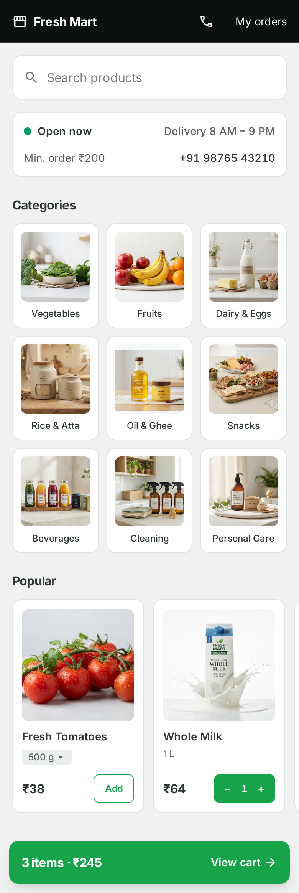
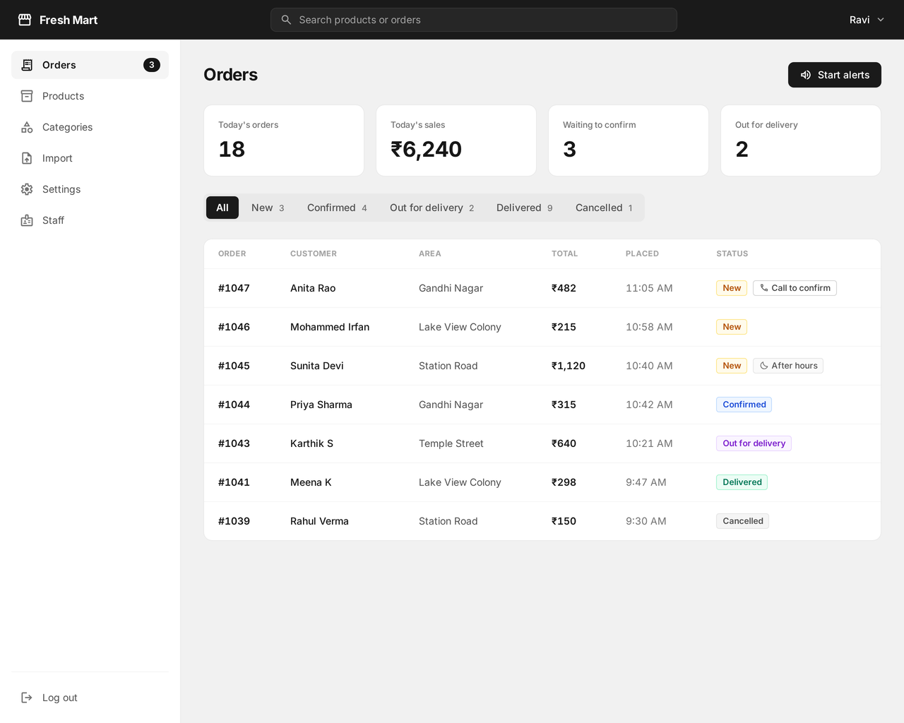

# Supermarket delivery

A delivery ordering website for a local supermarket. Customers browse the catalogue on their phone and place an order for home delivery; staff run the shop from an admin that shows new orders as they arrive.

Built for a real shop brief, end to end: spec, design, API, storefront, admin, tests and a production deployment with backups.

| Customer storefront | Staff admin |
| --- | --- |
|  |  |

<sub>Design reference screens from `docs/design/`. The build follows them for layout.</sub>

## What it does

**For customers**

- Browse by category and search the catalogue
- Cart with pack sizes, checkout by delivery area
- Order status page, order history and one-tap reorder
- Checkout safeguards: a price or stock change since the cart was filled is shown before the order is placed

**For staff**

- Live orders list with alerts and a new-orders badge
- Move orders through their statuses, edit order lines, cancel
- Manage products, photos, categories, delivery areas and shop settings
- Global search across orders and products

## Stack

| Part | Built with |
| --- | --- |
| API (`api/`) | Django, Django Ninja, PostgreSQL, pytest, uv |
| Web (`web/`) | Next.js App Router, TypeScript, Tailwind CSS, shadcn/ui, Playwright, pnpm |
| Proxy (`proxy/`) | Caddy: `/api` goes to Django, everything else to Next.js |
| Deploy (`ops/`, `compose.prod.yaml`) | Docker Compose on a single ARM server, images built by GitHub Actions, nightly backups to two destinations |

## Things worth a look

- **One design-token file.** Every colour, size and spacing value lives in `web/src/styles/tokens.css`. A CI check fails the build on any hard-coded value, and another checks every text/background pair against WCAG AA.
- **Decisions are written down.** See `docs/adr/` for why the components are our own and why Tailwind's colour palette was removed.
- **Spec and tickets are in the repo.** `.scratch/delivery-v1/spec.md` is the full spec; each ticket beside it is one vertical slice.
- **Backups are rehearsed.** `ops/drill.sh` runs a backup and a restore locally with Docker only.

## Run locally

Needs Docker with Compose, plus uv and pnpm for working outside the containers.

```bash
cp .env.example .env
docker compose up --build
```

The site is at http://localhost:8090 (`PROXY_PORT` in `.env`).

The staff admin is at http://localhost:8090/admin. Create the first Staff Member from the command line; after that, staff add each other from the admin:

```bash
docker compose exec api python manage.py createsuperuser --email ""
```

## Tests and checks

```bash
docker compose run --rm api pytest      # API tests against Postgres
cd web && pnpm test:e2e                 # Playwright, phone-sized, against the running stack
cd web && pnpm check:tokens             # no hard-coded values outside web/src/styles/tokens.css
cd web && pnpm check:contrast           # every text/background token pair meets WCAG AA
cd web && pnpm test:unit && pnpm typecheck
```

Playwright needs its browser once: `cd web && pnpm exec playwright install chromium`.

## Deployment

Production runs on a single ARM server with `compose.prod.yaml`; see `docs/deployment.md` for setup, updates, backups, restore and handover.
