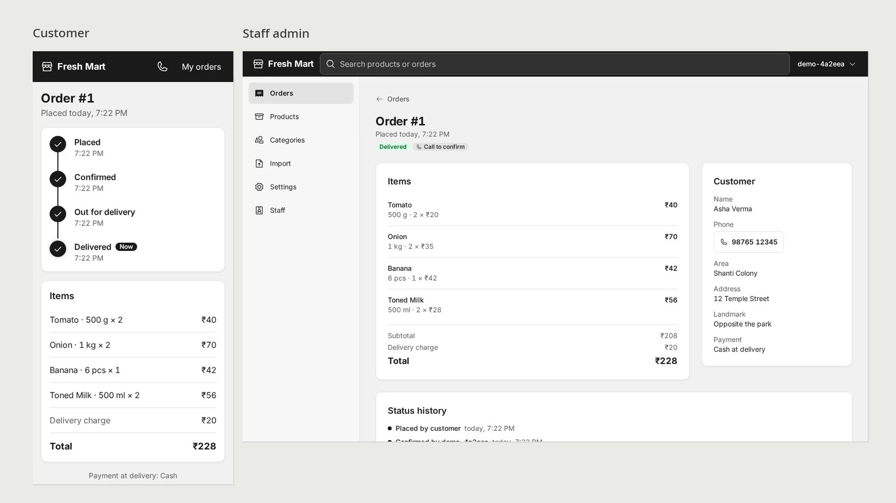

# Supermarket Delivery

A delivery ordering website for a local supermarket. Customers order groceries from their phone; staff manage every order from a live admin.

<!-- To play inline on GitHub: drag docs/demo.mp4 into the README editor on github.com and replace this link with the user-attachments URL it gives you. -->
[](docs/demo.mp4)

## Core functionality

**Customer (phone)**

- Browse categories, search the catalogue and pick a pack size on each product
- Cart with a running total, delivery charge and the shop's minimum order
- Checkout with name, phone, delivery area, address and Cash or UPI at delivery
- If a price or stock changes after an item is added, the customer sees it before the order is placed
- A private status link that follows the order from Placed to Delivered, plus order history and reorder

**Staff (admin)**

- Live orders list with sound alerts and a new-orders badge
- Confirm, edit, cancel and move orders through Confirmed, Out for delivery and Delivered
- Manage products, photos, categories, delivery areas, shop settings and staff accounts
- CSV product import, bulk photo upload and global search across orders and products

## Tech stack

[](#tech-stack)

<sub>Also: Django Ninja, shadcn/ui, Playwright, pytest, uv, Caddy</sub>

## Run locally

Needs Docker with Compose, plus uv and pnpm for working outside the containers.

```bash
cp .env.example .env
docker compose up --build
```

The site is at http://localhost:8090 (`PROXY_PORT` in `.env`) and the staff admin at http://localhost:8090/admin.

Create the first staff member from the command line; after that, staff add each other from the admin:

```bash
docker compose exec api python manage.py createsuperuser --email ""
```

## Checks and tests

```bash
docker compose run --rm api pytest      # API tests against Postgres
cd web && pnpm test:e2e                 # Playwright, phone-sized, against the running stack
cd web && pnpm check:tokens             # no hard-coded values outside web/src/styles/tokens.css
cd web && pnpm check:contrast           # every text/background token pair meets WCAG AA
cd web && pnpm test:unit && pnpm typecheck
```

Playwright needs its browser once: `cd web && pnpm exec playwright install chromium`.
